<div align="center">



<p>
  
  
  
  
</p>

<p><em>A one-page portfolio for a full-stack developer based in Istanbul,<br>
from customer support at scale to shipping React and Node.js products.</em></p>

</div>


## What it is

Brand New Day is a personal portfolio built around a career change: years of solving problems for European marketplace sellers, then a move into full-stack development. The page tells that story in four scroll-driven sections, with a marquee of skills and project cards that open into detail.

| Section | |
|---|---|
| **Hero** | A bold headline with GSAP-driven entrance and a skills marquee. |
| **About** | The path from operations to engineering. |
| **Skills** | Frontend, backend and tooling, grouped and animated on scroll. |
| **Projects** | Selected work with stacks, links and screenshots. |
| **Contact** | Direct links and a CV download. |


## Türkçe özet

**Brand New Day**, İstanbul'da yaşayan bir full-stack geliştiricinin tek sayfalık portfolyo sitesi. Avrupa pazar yeri satıcılarına destek verdiği yıllardan React ve Node.js ürünleri geliştirmeye uzanan kariyer değişimini anlatıyor. Hakkımda, yetenekler, projeler ve iletişim bölümleri GSAP ile kaydırmaya bağlı animasyonlarla açılıyor. Next.js, TypeScript ve shadcn/ui ile yapıldı.


## Development

```sh
npm install
npm run dev      # http://localhost:3000
npm run build
```

```
src/app/          layout and page
src/components/   Navbar, Hero, About, Skills, Projects, Contact, ui
src/data/         navigation, marquee, about text, skills and projects
docs/research/    reference notes for the layout
```

<div align="center">
<br>
<a href="https://github.com/kutluhangil"></a>
<sub>Every day is a chance to rebuild.</sub>
</div>
